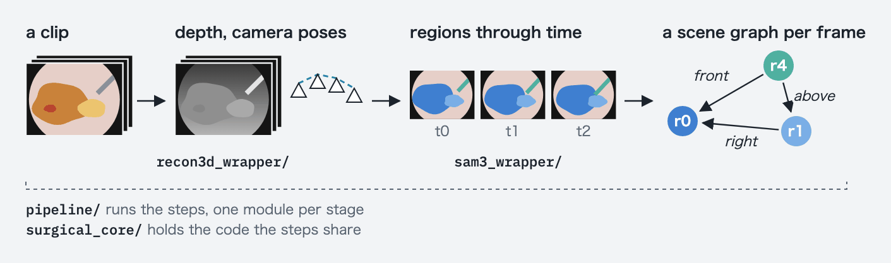
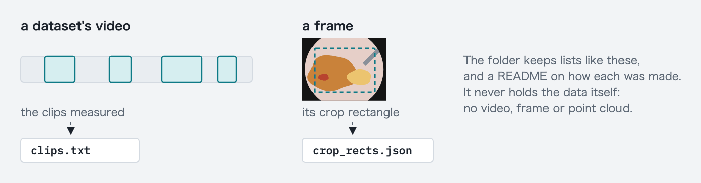
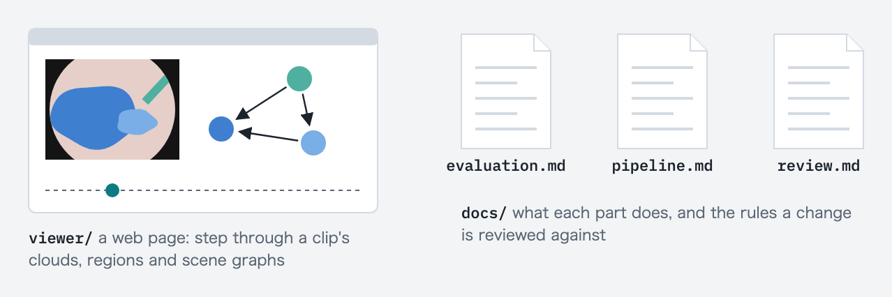

# omnisurg-4d-scene-graph

This repository turns a clip, a stretch of a video of minimally invasive
surgery, into a **4D** (3D + time) scene graph. The pipeline places each
frame in 3D, follows the regions of the first frame through time, and lists
how the regions lie and move relative to each other. No model is trained;
the pipeline combines existing ones. The repository accompanies the paper
*Toward 4D Surgical Scene Understanding Beyond Cholecystectomy: An
Assessment of 4D Scene Graph Construction and Validation*, submitted to
IPCAI 2027.

![Fig. 1 of the paper. Top: prior work built 4D scene graphs on one procedure, cholecystectomy, shown by eight CholecSeg8k clips. Below: this work builds them on the 14 procedures of ATLAS-120k, cholecystectomy among them; the other 13 are cells on a drawing of the body: esophagectomy, liver resection, colectomy, hemicolectomy, appendectomy, radical prostatectomy, adrenalectomy, splenectomy, gastric surgery, gastrojejunostomy, sigmoid colectomy, low anterior resection and rectopexy; each cell shows three frames of a clip and its point cloud with the camera path.](docs/figures/paper_procedures.png)

## Contents

- [From a clip to a scene graph](#from-a-clip-to-a-scene-graph): how a
  graph is built, and how each part of it is scored
- [Where to start](#where-to-start): which page to read for what
- [What is where](#what-is-where): the folders, by what they do
- [Install](#install) and [Tests](#tests)
- [Paper](#paper) and [What this release holds](#what-this-release-holds)
- [License](#license)

## From a clip to a scene graph

![Fig. 2 of the paper. (a) How a graph is built: a clip; its depth and camera poses; the first frame's regions, here the reference masks, tracked through the clip; a graph per frame; and the graphs linked through time. (b) How each part is scored, without reprojection in the upper row and with it in the lower row. Geometry: depth against stereo depth and scans, and the camera path against kinematics and an optical tracker, on StereoMIS and D4D; reprojection consistency without ground truth. Nodes: tracking one class mask against the reference masks of ATLAS-120k and CholecSeg8k; reference masks reprojected 2.7 s later, by class group. Graph: the graph read as 2D, temporal, 3D and camera statements; exits told from tracking losses by projecting a node's last position with the camera poses.](docs/figures/paper_method.png)

Each part of the graph is scored against the reference that exists for
it; no dataset has a reference for a whole 4D graph.

- Geometry: depth and camera paths against two porcine datasets, StereoMIS
  and D4D. `trajectory_eval`, the camera trajectory scorer, compares the
  camera's path with the true path.
- Nodes: the tracked regions against the masks drawn by hand in
  ATLAS-120k and CholecSeg8k. `evalkit`, the evaluator, compares them.
- Graph: the 2D and temporal statements counted on the annotated masks,
  and the exits a graph reports against the annotated disappearances.

[What this release holds](#what-this-release-holds) lists the stages and
scorers behind them.

## Where to start

- To see what is measured: [`evalkit/README.md`](evalkit/README.md) puts
  the three questions on one drawn scene, and
  [`docs/evaluation.md`](docs/evaluation.md) gives the full rules.
- To run the pipeline: [Install](#install) below, then
  [`docs/pipeline.md`](docs/pipeline.md), which lists the stages in the
  order they run.
- To change the code: [`docs/review.md`](docs/review.md), the rules a
  change is reviewed against.

## What is where

### Make the scene graphs



[`docs/pipeline.md`](docs/pipeline.md) says how to run each stage.

| folder | what it holds |
|---|---|
| [`pipeline/`](pipeline/) | the stages; each runs as `python -m pipeline.<stage>` |
| [`recon3d_wrapper/`](recon3d_wrapper/) | the depth models, Depth Anything 3 and Pi3X |
| [`sam3_wrapper/`](sam3_wrapper/) | SAM 3, which follows the regions through time |
| [`surgical_core/`](surgical_core/) | code the stages and the tools share: dataset readers, geometry, the viewer's data model; the evaluator uses none of it |

### Score the results


[`evalkit/README.md`](evalkit/README.md) says how the regions are scored.
[`docs/pipeline.md`, "The StereoMIS camera trajectory scores"](docs/pipeline.md#the-stereomis-camera-trajectory-scores)
says how the camera's path is scored.

| folder | what it holds |
|---|---|
| [`evalkit/`](evalkit/) | the evaluator, which scores the regions |
| [`evalkit/tools/`](evalkit/tools/) | tools that read the scores or the regions: comparisons, tables, statistics |
| [`trajectory_eval/`](trajectory_eval/) | the camera trajectory scorer, which scores the camera's path; its `tools/` run it on StereoMIS and read the scores |

Each scorer records a hash of its own code with every score:
`eval_code_sha` and `trajectory_code_sha`. Two scores are compared only
when their hashes match. The tools are not part of either hash.

### Describe the datasets



Each folder's README says how its files were made. None holds the data
itself: no video, frame or point cloud.

| folder | what it holds |
|---|---|
| [`atlas120k_meta/`](atlas120k_meta/) | ATLAS-120k: the clips measured, their crop rectangles and frame ratios |
| [`cholecseg8k_meta/`](cholecseg8k_meta/) | CholecSeg8k: the clips measured and their crop rectangles |
| [`d4d_meta/`](d4d_meta/) | D4D: the clips the census measures, and the sides the measurements score |

### Show and explain



[`viewer/README.md`](viewer/README.md) says how to run the page and
publish it.

| folder | what it holds |
|---|---|
| [`viewer/`](viewer/) | the web page that shows a clip's scene graphs |
| [`docs/`](docs/) | the specifications, and [`docs/review.md`](docs/review.md), the rules a change is reviewed against |

## Install

The evaluation toolkit needs Python 3.12 or newer; `pip` brings the rest:

```bash
pip install -e .
```

The pipeline needs a Linux machine with an NVIDIA GPU and its driver, and
Python 3.12. Python 3.12 is the newest Python it supports, because Depth
Anything 3 (DA3) requires `numpy` below 2. On a newer Python the install fails
while resolving packages, and the error does not name the Python version as
the reason. A machine without a GPU can run the depth stage slowly;
`docs/pipeline.md` gives the steps.

```bash
git clone https://github.com/TaiToTo/omnisurg-4d-scene-graph.git
cd omnisurg-4d-scene-graph
python3.12 -m venv .venv && . .venv/bin/activate
pip install -e ".[recon3d]"
python -m pipeline.depth --input-dir /path/to/clips --clips <clip>
python -m pipeline.pi3x --input-dir /path/to/clips --clips <clip>
```

The model weights download from Hugging Face on first use: about 1.4 GB for
DA3-LARGE and 5.1 GB for Pi3X. Both are licensed CC BY-NC 4.0, for
non-commercial use only, unlike this repository's code. `docs/pipeline.md`
describes a clip and the files each stage writes.

The D4D census, the depth stage and the trajectory command's `select` and
`prepare` read the dataset through D4D's own loader, which pip cannot
install. Clone the loader at the commit that `surgical_core.d4d` checks, and
put the clone on `PYTHONPATH`. They refuse to run without the loader, or with
files other than that commit's.

```bash
git clone https://github.com/reubendocea/d4d.git /path/to/d4d
git -C /path/to/d4d checkout efe12d26
pip install -e ".[d4d]"
export PYTHONPATH=/path/to/d4d
```

## Tests

Run the tests with the three extras, as CI does. Without them the tests
that need matplotlib, trimesh or scipy are skipped, and the run still looks
green.

```bash
pip install -e ".[render,tools,stereomis]" pytest
pytest
```

## Paper

Yasuto Tamura, Masakazu Iwamura and Koichi Kise. *Toward 4D Surgical Scene
Understanding Beyond Cholecystectomy: An Assessment of 4D Scene Graph
Construction and Validation.* Submitted to IPCAI 2027.

## What this release holds

- The pipeline's stages: the extraction of ATLAS-120k, CholecSeg8k,
  StereoMIS and D4D clips; depth and camera poses from Depth Anything 3 and
  Pi3X; and the tracking of the first frame's regions with SAM 3.
- The two scorers: `evalkit` for the tracked regions and
  `trajectory_eval` for the camera paths. Each score records the hash of
  the code that made it, `eval_code_sha` or `trajectory_code_sha`, and two
  scores are compared only when their hashes match.
- The clip lists of the four datasets, with the crop rectangles and cut
  table of ATLAS-120k, so that a measurement reads the same clips.
- The viewer, a web page that steps through a clip's point clouds, regions
  and scene graphs.

[`paper/ipcai2027/README.md`](paper/ipcai2027/README.md) lists each of
the paper's numbers with the command that prints it from the pipeline's
outputs. [`docs/porting.md`](docs/porting.md) says
what each part was checked against.

## License

Apache-2.0. Copyright 2026 Yasuto Tamura.
