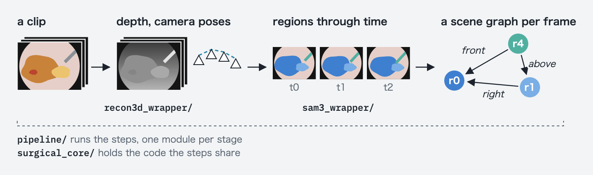
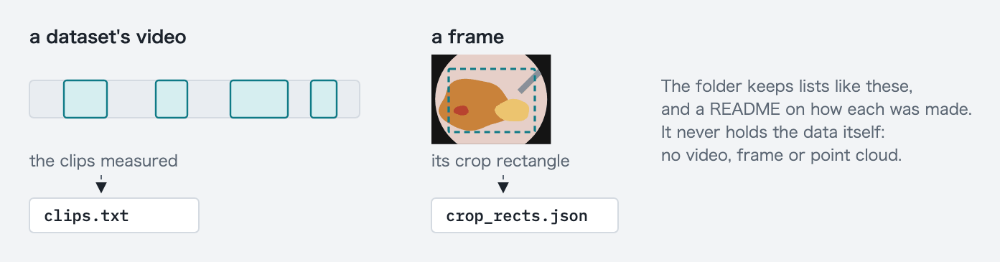
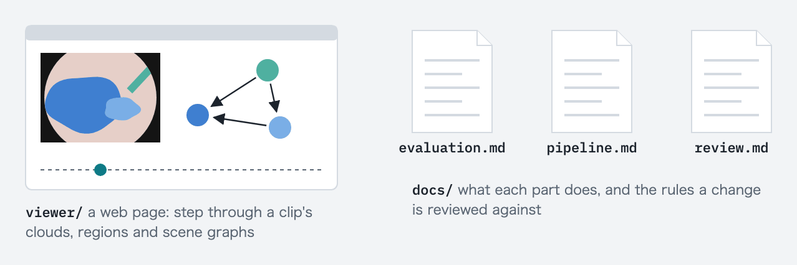

# omnisurg-4d-scene-graph

This repository turns a clip, a stretch of a video of minimally invasive
surgery, into a **4D** (3D + time) scene graph. The pipeline cuts each
frame into regions, places them in 3D and follows them through time. A
frame's scene graph lists its regions and says where each lies from the
others: right, above, in front, and so on. No model is trained; the
pipeline combines existing ones.

## Contents

- [From a clip to a scene graph](#from-a-clip-to-a-scene-graph): the
  steps in one figure, and what is scored
- [Where to start](#where-to-start): which page to read for what
- [What is where](#what-is-where): the folders, by what they do
- [Install](#install) and [Tests](#tests)
- [Status](#status): what has been moved here so far
- [License](#license)

## From a clip to a scene graph

![From a clip to a 4D scene graph, on a drawn scene: 1, the clip's frames; 2, a depth map and a point cloud per frame, and the camera's path; 3, regions that keep their ids from frame to frame and have no names; 4, a scene graph per frame, a node per region and a word per pair such as right, front or above; 5, the same relations through time, each holding for a run of frames, and the viewer that shows them. Below, what is scored: the camera poses against StereoMIS's ground truth by trajectory_eval, and the regions against the hand-labelled GT masks by evalkit.](docs/figures/scene_graph_overview.png)

The figure draws the steps on a made-up scene. Two scorers check the
results, not the scene graphs:

- `evalkit`, the evaluator, compares the regions with masks drawn by hand,
  in ATLAS-120k, CholecSeg8k and LapEx.
- `trajectory_eval`, the camera trajectory scorer, compares the camera's
  path with the true path, in StereoMIS.

## Where to start

- To see what is measured: [`evalkit/README.md`](evalkit/README.md) puts
  the three questions on one drawn scene, and
  [`docs/evaluation.md`](docs/evaluation.md) gives the full rules.
- To run the pipeline: [Install](#install) below, then
  [`docs/pipeline.md`](docs/pipeline.md), which lists the stages in the
  order they run.
- To change the code: [`docs/review.md`](docs/review.md), the rules a
  change is reviewed against.

## What is where

### Make the scene graphs



[`docs/pipeline.md`](docs/pipeline.md) says how to run each stage.

| folder | what it holds |
|---|---|
| [`pipeline/`](pipeline/) | the stages; each runs as `python -m pipeline.<stage>` |
| [`recon3d_wrapper/`](recon3d_wrapper/) | the depth models, Depth Anything 3 and Pi3X |
| [`sam3_wrapper/`](sam3_wrapper/) | SAM 3, which follows the regions through time |
| [`surgical_core/`](surgical_core/) | code the stages and the tools share: dataset readers, geometry, the viewer's data model; the evaluator uses none of it |

### Score the results


[`evalkit/README.md`](evalkit/README.md) says how the regions are scored.
[`docs/pipeline.md`, "The StereoMIS camera trajectory scores"](docs/pipeline.md#the-stereomis-camera-trajectory-scores)
says how the camera's path is scored.

| folder | what it holds |
|---|---|
| [`evalkit/`](evalkit/) | the evaluator, which scores the regions |
| [`evalkit/tools/`](evalkit/tools/) | tools that read the scores or the regions: comparisons, tables, statistics |
| [`trajectory_eval/`](trajectory_eval/) | the camera trajectory scorer, which scores the camera's path; its `tools/` run it on StereoMIS and read the scores |

Each scorer records a hash of its own code with every score:
`eval_code_sha` and `trajectory_code_sha`. Two scores are compared only
when their hashes match. The tools are not part of either hash.

### Describe the datasets



Each folder's README says how its files were made. None holds the data
itself: no video, frame or point cloud.

| folder | what it holds |
|---|---|
| [`atlas120k_meta/`](atlas120k_meta/) | ATLAS-120k: the clips measured, their crop rectangles and frame ratios |
| [`cholecseg8k_meta/`](cholecseg8k_meta/) | CholecSeg8k: the clips measured and their crop rectangles |
| [`d4d_meta/`](d4d_meta/) | D4D: the clips the census measures, and the sides the measurements score |

### Show and explain



[`viewer/README.md`](viewer/README.md) says how to run the page and
publish it.

| folder | what it holds |
|---|---|
| [`viewer/`](viewer/) | the web page that shows a clip's scene graphs |
| [`docs/`](docs/) | the specifications, and [`docs/review.md`](docs/review.md), the rules a change is reviewed against |

## Install

The evaluation toolkit needs Python 3.12 or newer; `pip` brings the rest:

```bash
pip install -e .
```

The pipeline needs a Linux machine with an NVIDIA GPU and its driver, and
Python 3.12. Python 3.12 is the newest Python it supports, because Depth
Anything 3 (DA3) requires `numpy` below 2. On a newer Python the install fails
while resolving packages, and the error does not name the Python version as
the reason. A machine without a GPU can run the depth stage slowly;
`docs/pipeline.md` gives the steps.

```bash
git clone https://github.com/TaiToTo/omnisurg-4d-scene-graph.git
cd omnisurg-4d-scene-graph
python3.12 -m venv .venv && . .venv/bin/activate
pip install -e ".[recon3d]"
python -m pipeline.depth --input-dir /path/to/clips --clips <clip>
python -m pipeline.pi3x --input-dir /path/to/clips --clips <clip>
```

The model weights download from Hugging Face on first use: about 1.4 GB for
DA3-LARGE and 5.1 GB for Pi3X. Both are licensed CC BY-NC 4.0, for
non-commercial use only, unlike this repository's code. `docs/pipeline.md`
describes a clip and the files each stage writes.

The D4D census, the depth stage and the trajectory command's `select` and
`prepare` read the dataset through D4D's own loader, which pip cannot
install. Clone the loader at the commit that `surgical_core.d4d` checks, and
put the clone on `PYTHONPATH`. They refuse to run without the loader, or with
files other than that commit's.

```bash
git clone https://github.com/reubendocea/d4d.git /path/to/d4d
git -C /path/to/d4d checkout efe12d26
pip install -e ".[d4d]"
export PYTHONPATH=/path/to/d4d
```

## Tests

Run the tests with the three extras, as CI does. Without them the tests
that need matplotlib, trimesh or scipy are skipped, and the run still looks
green.

```bash
pip install -e ".[render,tools,stereomis]" pytest
pytest
```

## Status

The code is being moved here from the research workbench where the
measurements were made. The evaluator is not frozen yet, so its scores are
not final.

- Ported: the extraction stages and the D4D census, depth and camera
  poses, segmentation and tracking, the evaluator and its tools, the camera
  trajectory scorer, and the viewer.
- Not ported yet: the export stage, which builds the scene graphs; the
  paper's tables; and the D4D measurements after the census.

This repository alone takes a clip as far as tracked regions and their
scores. The viewer bundle stage reads scene graphs that the workbench's
export stage wrote. [`docs/porting.md`](docs/porting.md) says what each
part was checked against, what is left, and the decisions still to carry
out.

## License

Apache-2.0. Copyright 2026 Yasuto Tamura.
